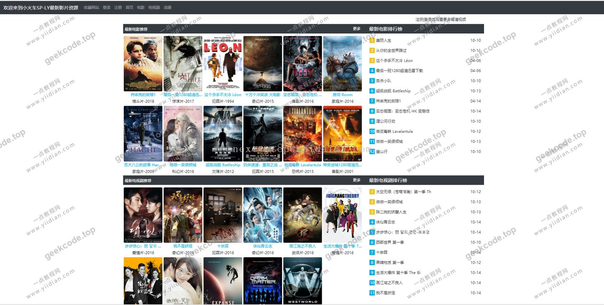
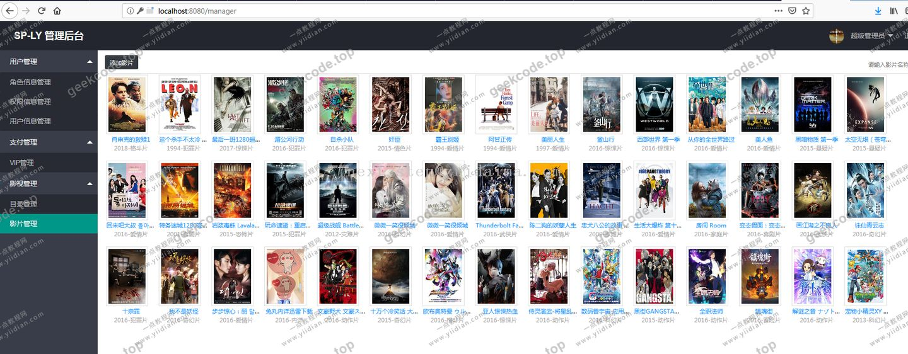
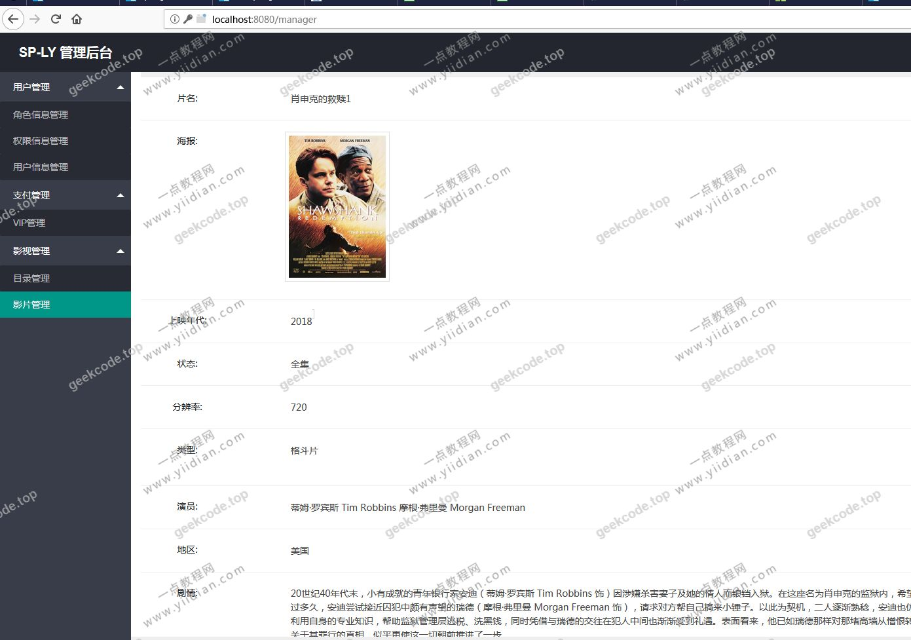

# java【毕业设计】精品项目-基于SpringBoot+LayUI的视频播放网站(权限采用SpringSecurity)

> 🎓 **计算机毕业设计 · java【毕业设计】精品项目-基于SpringBoot+LayUI的视频播放网站(权限采用SpringSecurity)**
>
> 本仓库只放**项目介绍 + 运行截图**（截图是站点带水印的原图，存在仓库 `images/` 里）。
>
> 👉 **完整可运行源码 / 数据库脚本 / 部署文档：[点我获取](https://geekcode.top/archives/java%E3%80%90%E6%AF%95%E4%B8%9A%E8%AE%BE%E8%AE%A1%E3%80%91%E7%B2%BE%E5%93%81%E9%A1%B9%E7%9B%AE-%E5%9F%BA%E4%BA%8ESpringBoot-LayUI%E7%9A%84%E8%A7%86%E9%A2%91%E6%92%AD%E6%94%BE%E7%BD%91%E7%AB%99-%E6%9D%83%E9%99%90%E9%87%87%E7%94%A8SpringSecurity?utm_source=github)**
>
> 💬 咨询微信：**ir9372**　|　🌐 更多项目：[极客代码 geekcode.top](https://geekcode.top/?utm_source=github)
>
> 📌 项目详情页：<https://geekcode.top/archives/java%E3%80%90%E6%AF%95%E4%B8%9A%E8%AE%BE%E8%AE%A1%E3%80%91%E7%B2%BE%E5%93%81%E9%A1%B9%E7%9B%AE-%E5%9F%BA%E4%BA%8ESpringBoot-LayUI%E7%9A%84%E8%A7%86%E9%A2%91%E6%92%AD%E6%94%BE%E7%BD%91%E7%AB%99-%E6%9D%83%E9%99%90%E9%87%87%E7%94%A8SpringSecurity?utm_source=github>

<table><td width="230" align="center"> <b>扫码加微信 ir9372</b></td><td valign="middle">📦 源码 = 项目介绍 + 全部运行截图 + 数据库 + 部署文档 👉 点上方任意截图，直接跳到 <b>极客代码 geekcode.top</b> 详情页</td></table>

---

<h1>java【毕业设计】精品项目-基于SpringBoot+LayUI的视频播放网站(权限采用SpringSecurity)</h1>
<h2>项目概述</h2>

本项目是一个基于 Spring Boot 框架开发的视频播放网站系统，旨在为用户提供流畅的视频浏览与播放体验。核心功能聚焦于前台视频内容的展示与交互，采用 LayUI 前端框架构建用户界面，后端通过 MyBatis 进行数据持久化操作，并集成 Spring Security 实现权限控制机制。该项目适用于计算机专业毕业设计场景，主要面向普通视频观看用户，提供简洁高效的媒体消费入口。技术架构上，项目采用前后端分离思想但侧重于静态页面渲染与动态数据结合，确保了系统的轻量级部署与快速响应能力。

<h2>技术架构</h2>
<h3>后端架构</h3>

项目后端基于 <strong>Spring Boot</strong> 框架构建，利用其自动配置特性简化开发流程。数据访问层采用 <strong>MyBatis</strong> 作为 ORM 框架，负责与 MySQL 数据库进行交互，实现视频元数据、用户信息等数据的 CRUD 操作。安全模块集成 <strong>Spring Security</strong>，用于处理身份验证和授权逻辑，确保只有具备相应权限的用户才能访问特定资源或执行敏感操作。

<h3>前端架构</h3>

前端界面使用 <strong>LayUI</strong> 框架开发，这是一个经典的前端 UI 组件库，提供了丰富的表单、表格、导航等组件，能够快速构建美观且兼容性良好的网页界面。根据项目类型标记为 <code>html-static</code>，表明前端主要通过 HTML/CSS/JS 静态资源结合后端模板引擎或 AJAX 请求来呈现动态内容。

<h3>核心技术选型理由</h3>
<ol>
<li><strong>Spring Boot</strong>: 提供“约定优于配置”的开发模式，降低搭建复杂度，适合毕设快速迭代。</li>
<li><strong>MyBatis</strong>: 相比 JPA，MyBatis 对 SQL 的控制更精细，便于优化查询性能，适合视频列表等多条件筛选场景。</li>
<li><strong>LayUI</strong>: 无需依赖复杂的 Node.js 构建工具链，直接引入即可使用，降低了前端工程化的门槛，符合 <code>html-static</code> 的项目定位。</li>
<li><strong>Spring Security</strong>: 业界标准的安全框架，能够可靠地保护应用免受常见攻击，满足权限管理需求。</li>
</ol>
<h3>数据库设计要点</h3>

虽然具体表结构未在上下文中详细列出，但基于视频网站的一般设计原则，数据库应包含以下核心实体：

<ul>
<li><strong>视频信息表</strong>：存储视频标题、封面图、播放地址、上传时间、分类标签等字段。</li>
<li><strong>用户表</strong>：存储用户名、密码（加密）、角色标识等基本信息。</li>
<li><strong>权限/角色表</strong>：配合 Spring Security 定义用户角色（如普通用户、管理员）及其对应的访问权限。</li>
</ul>
<h2>功能模块</h2>

根据提供的截图功能列表及项目描述，本项目主要包含前台用户端功能，后台管理端功能在当前上下文中标记为“无”。

<h3>前台用户端</h3>
<ol>
<li><strong>视频展示与播放</strong></li>
</ol>
<ul>
<li>首页展示推荐视频列表，支持分页加载。</li>
<li>视频详情页提供播放器嵌入，支持在线播放。</li>
<li>视频分类浏览，允许用户按类别查找内容。</li>
</ul>
<ol start="2">
<li><strong>用户认证与权限</strong></li>
</ol>
<ul>
<li>登录/注册页面：集成 Spring Security 的表单登录机制。</li>
<li>受保护资源访问：部分视频或功能可能需要登录后才能访问，未登录用户将被重定向至登录页。</li>
</ul>
<ol start="3">
<li><strong>界面交互</strong></li>
</ol>
<ul>
<li>基于 LayUI 构建的响应式布局，适配不同屏幕尺寸。</li>
<li>导航菜单与个人中心入口（尽管具体菜单项为空，但界面框架已预留）。</li>
</ul>
<h3>后台管理端</h3>
<ul>
<li><strong>当前状态</strong>：根据输入信息“是否有后台: 否”及“后台路由 (无)”，本项目不包含独立的后台管理界面或路由配置。所有管理操作可能通过直接数据库操作或未在文档中体现的内部接口完成，或者该项目仅专注于前台展示。</li>
</ul>
<h2>用户角色与权限</h2>

项目集成了 Spring Security，因此存在基本的权限控制体系。根据现有信息，可推断的角色如下：

<h3>1. 游客 (Anonymous User)</h3>
<ul>
<li><strong>权限范围</strong>：</li>
<li>访问公开的视频列表页面。</li>
<li>查看视频基本简介。</li>
<li><strong>限制</strong>：无法执行需要身份验证的操作（如点赞、评论、下载或访问私密视频），若尝试访问受保护资源，将被拦截并跳转至登录页面。</li>
</ul>
<h3>2. 注册用户 (Authenticated User)</h3>
<ul>
<li><strong>权限范围</strong>：</li>
<li>成功登录后，拥有基础用户权限。</li>
<li>可以访问所有公开视频内容。</li>
<li>可能具备访问个人中心、查看历史记录等功能（具体取决于代码中未列出的细节，但通常 Spring Security 配置会区分匿名与认证用户）。</li>
<li><strong>限制</strong>：若无特殊管理员角色配置，无法进入后台管理系统（因本项目无后台）。</li>
</ul>
<h3>3. 管理员 (Admin)</h3>
<ul>
<li><strong>说明</strong>：由于项目明确标记“是否有后台: 否”且无后台路由，<strong>根据现有信息无法确定</strong>是否存在独立的管理员角色及其具体功能。如果存在管理员，其权限通常涵盖用户管理和视频审核，但在本项目的可见范围内，这些功能未在前台或后台界面中体现。</li>
</ul>

<strong>权限矩阵总结：</strong>

<table>
<thead>
<tr>
<th align="left">功能模块</th>
<th align="center">游客</th>
<th align="center">注册用户</th>
<th align="center">管理员 (推测)</th>
</tr>
</thead>
<tbody><tr>
<td align="left">浏览视频列表</td>
<td align="center">✅</td>
<td align="center">✅</td>
<td align="center">✅</td>
</tr>
<tr>
<td align="left">播放视频</td>
<td align="center">✅</td>
<td align="center">✅</td>
<td align="center">✅</td>
</tr>
<tr>
<td align="left">访问个人中心</td>
<td align="center">❌</td>
<td align="center">✅</td>
<td align="center">✅</td>
</tr>
<tr>
<td align="left">后台管理功能</td>
<td align="center">❌</td>
<td align="center">❌</td>
<td align="center">⚠️ (无后台界面)</td>
</tr>
</tbody></table>

<em>(注：✅ 表示可访问，❌ 表示不可访问，⚠️ 表示根据现有信息无法确定)</em>

<h2>项目特色与创新点</h2>
<ol>
<li>
<strong>轻量化技术栈组合</strong>：
   采用 Spring Boot + MyBatis + LayUI 的组合，避开了复杂的前端构建工具（如 Webpack/Vite）和重型前端框架（如 Vue/React 的完整工程化），实现了快速开发与部署。这种架构特别适合教学演示和中小型静态为主的网站项目。

</li>
<li>
<strong>标准化安全集成</strong>：
   将 Spring Security 深度整合到项目中，而非自行编写简单的 Session 校验。这展示了企业对级安全框架在实际项目中的应用方式，包括过滤器链的配置、自定义用户详情服务（UserDetailsService）以及访问决策策略，具有较高的技术参考价值。

</li>
<li>
<strong>专注前台体验</strong>：
   项目剥离了传统的后台管理界面，专注于前台用户的视觉呈现和视频播放体验。通过 LayUI 的美观组件库，提升了页面的交互质感和视觉一致性，体现了“前端即产品”的设计理念。

</li>
<li>
<strong>清晰的权限边界</strong>：
   利用 Spring Security 明确划分了匿名访问与认证访问的界限，确保了核心视频资源的安全性，同时保留了公共信息的开放性，符合现代互联网产品的通用设计规范。

</li>
</ol>
<h2>部署环境</h2>

为确保项目正常运行，需准备以下软件环境：

<ol>
<li><strong>Java 运行环境</strong>：</li>
</ol>
<ul>
<li>JDK 版本：建议 JDK 8 或 JDK 11（兼容主流 Spring Boot 版本）。</li>
<li>环境变量：需配置 <code>JAVA_HOME</code> 和 <code>PATH</code>。</li>
</ul>
<ol start="2">
<li><strong>数据库</strong>：</li>
</ol>
<ul>
<li>MySQL 5.7 或 MySQL 8.0。</li>
<li>需创建对应数据库实例，并导入初始化 SQL 脚本以建立表结构和基础数据。</li>
</ul>
<ol start="3">
<li><strong>构建工具</strong>：</li>
</ol>
<ul>
<li>Maven 3.6+ 或 Gradle（取决于项目具体构建文件，通常 Spring Boot 默认使用 Maven）。</li>
<li>用于依赖管理和项目打包。</li>
</ul>
<ol start="4">
<li><strong>Web 服务器</strong>：</li>
</ol>
<ul>
<li>内置 Tomcat（由 Spring Boot Starter Web 提供，无需单独安装外部 Tomcat）。</li>
<li>若生产环境部署，可使用 Nginx 作为反向代理服务器。</li>
</ul>
<ol start="5">
<li><strong>浏览器</strong>：</li>
</ol>
<ul>
<li>Chrome, Firefox, Edge 等现代浏览器，以确保 LayUI 组件的正常渲染和 JavaScript 功能的执行。</li>
</ul>
<ol start="6">
<li><strong>IDE (开发阶段)</strong>：</li>
</ol>
<ul>
<li>IntelliJ IDEA 或 Eclipse，用于代码编辑、调试和项目运行。</li>
</ul>
<h2>六、功能模块截图</h2>
<h3>前台用户端</h3>
<h4>系统运行界面1</h4>

<h4>系统运行界面2</h4>

<h4>系统运行界面3</h4>

---

## 获取完整源码

| 项目 | 说明 |
| --- | --- |
| 项目名 | java【毕业设计】精品项目-基于SpringBoot+LayUI的视频播放网站(权限采用SpringSecurity) |
| 运行截图 | 本文 3 张（站点带水印原图，仓库 `images/` 目录） |
| 完整源码 | [https://geekcode.top/archives/java%E3%80%90%E6%AF%95%E4%B8%9A%E8%AE%BE%E8%AE%A1%E3%80%91%E7%B2%BE%E5%93%81%E9%A1%B9%E7%9B%AE-%E5%9F%BA%E4%BA%8ESpringBoot-LayUI%E7%9A%84%E8%A7%86%E9%A2%91%E6%92%AD%E6%94%BE%E7%BD%91%E7%AB%99-%E6%9D%83%E9%99%90%E9%87%87%E7%94%A8SpringSecurity?utm_source=github](https://geekcode.top/archives/java%E3%80%90%E6%AF%95%E4%B8%9A%E8%AE%BE%E8%AE%A1%E3%80%91%E7%B2%BE%E5%93%81%E9%A1%B9%E7%9B%AE-%E5%9F%BA%E4%BA%8ESpringBoot-LayUI%E7%9A%84%E8%A7%86%E9%A2%91%E6%92%AD%E6%94%BE%E7%BD%91%E7%AB%99-%E6%9D%83%E9%99%90%E9%87%87%E7%94%A8SpringSecurity?utm_source=github) |
| 咨询微信 | **ir9372**（备注：jingpin-yuanma） |
| 更多项目 | [极客代码 geekcode.top](https://geekcode.top/?utm_source=github) |

> 需要源码、部署、改配置、跑不起来等问题，加微信 ir9372 沟通，说明项目名即可。
